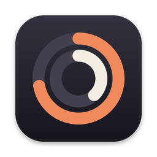

<p align="center">
  
</p>

<h1 align="center">Usage Bar for Claude</h1>

<p align="center">
  A tiny macOS menu bar app that shows your Claude plan usage at a glance:<br>
  the current 5-hour session and the weekly limit.
</p>

<p align="center">
  
  
  
  
</p>

> **Unofficial.** This is an independent project. It is not affiliated with, endorsed by,
> or supported by Anthropic. "Claude" is a trademark of Anthropic.

---

## What it shows

```
◔ 5h 50%  7d 21%
```

- **◔** a ring that fills up as the current session is used
- **5h** the current session (the rolling 5-hour window)
- **7d** the weekly limit across all models

Each number is colour-coded right in the menu bar:

| Usage | Colour |
|---|---|
| 0–50% | 🟢 Green |
| 51–75% | 🟡 Yellow |
| 76–90% | 🟠 Orange |
| 91–100% | 🔴 Red |

Click it for a dropdown with a progress bar and reset time for every limit your plan
has (for example per-model weekly limits or extra usage), plus Refresh, Sign In / Sign Out
and Launch at Login.

Figures refresh every 30 seconds, after the Mac wakes, and on demand (⌘R in the dropdown).

## Requirements

- macOS 13 Ventura or later (Apple silicon or Intel)
- Apple's Command Line Tools, to compile it. Install them once with:
  ```
  xcode-select --install
  ```
- A Claude account that you can sign in to at claude.ai (built and tested with a paid plan)

## Install

```bash
git clone https://github.com/rustybinary/usage-bar-for-claude.git
cd usage-bar-for-claude
bash build.sh
```

`build.sh` compiles the app, signs it for your Mac only, installs it as
`~/Applications/UsageBarForClaude.app` and starts it. Run the same command again after
pulling updates.

There is no prebuilt download: building it yourself means macOS trusts it without
any "unidentified developer" warning, and you can read every line that runs.

## First run

1. A **Sign in to Claude** window opens. Sign in exactly as you would on claude.ai.
2. The window closes by itself once you are in, and the numbers appear in the menu bar.
3. To place it next to another menu bar icon, hold **⌘** and drag it. macOS remembers the spot.
4. Optional: choose **Launch at Login** in the dropdown.

**If "Continue with Google" does not work inside the app**, use the email sign-in, or
choose **Sign In with Session Key…** from the dropdown:

1. Sign in to claude.ai in your normal browser.
2. Open Developer Tools → Application (Chrome) or Storage (Safari/Firefox) → Cookies → `https://claude.ai`.
3. Copy the value of `sessionKey` and paste it into the app.

## How it works

The app keeps a hidden web view signed in to claude.ai. On each refresh it asks claude.ai
for the same figures that **Settings → Usage** shows:

```
GET https://claude.ai/api/organizations/{organization-id}/usage
```

The response contains a utilisation percentage and a reset time for each window
(`five_hour`, `seven_day`, and any others your plan has). The organisation ID is looked up
once with `GET /api/organizations` and remembered.

**Does it use up my limits?** No. It never sends a message to a model; it only reads the
usage figures, like opening the Usage page does.

> ⚠️ This endpoint is **not a documented or public API**. Anthropic can change or remove it at
> any time, and the app will then show `–` until it is updated. Please review
> [Anthropic's Terms of Service](https://www.anthropic.com/legal/consumer-terms) and decide for
> yourself whether to use it. Use at your own risk.

## Privacy

- The only network requests go to `claude.ai`. There is no analytics, telemetry or server of any kind.
- Your sign-in stays on your Mac, in the app's own web data:
  `~/Library/WebKit/io.github.rustybinary.usage-bar-for-claude`
- The app remembers only your organisation ID (in its preferences) so it can skip a lookup.
- **Sign Out** in the dropdown deletes the app's cookies and web data.

## Settings

Edit the constants at the top of [`Sources/App.swift`](Sources/App.swift) and run `bash build.sh` again:

| Constant | Default | Meaning |
|---|---|---|
| `refreshInterval` | `30` | Seconds between refreshes |
| `signedOutInterval` | `300` | Seconds between checks while signed out |
| `greenUpTo` | `50` | Highest percentage shown in green |
| `yellowUpTo` | `75` | Highest percentage shown in yellow |
| `orangeUpTo` | `90` | Highest percentage shown in orange; above this is red |

If the dropdown ever shows **"Last refresh failed: … HTTP 429"**, claude.ai is asking for
fewer requests. Raise `refreshInterval`.

## Troubleshooting

| You see | Try |
|---|---|
| `Sign in` in the menu bar | Choose **Sign In to Claude…** from the dropdown |
| `–` in the menu bar | Open the dropdown to see the error; check your connection, then **Refresh Now** |
| `…` for a long time | **Refresh Now**; if it persists, **Sign Out** and sign in again |
| `xcrun: error` when building | Install the Command Line Tools: `xcode-select --install` |
| "failed with error -600" at the end of the build | The app was still quitting; run `open ~/Applications/UsageBarForClaude.app` |

## Project layout

```
Sources/App.swift     menu bar item, dropdown, sign-in, usage requests
Sources/Entry.swift   app entry point
Info.plist            app metadata (menu bar only, no Dock icon)
AppIcon.icns          app icon
build.sh              compile, sign, install and start
```

No Xcode project and no third-party packages: just AppKit, WebKit and ServiceManagement.

## Uninstall

1. Choose **Quit Usage Bar for Claude** from the dropdown (turn off **Launch at Login** first if you enabled it).
2. Delete `~/Applications/UsageBarForClaude.app`.
3. Optionally delete its data:
   ```bash
   rm -rf ~/Library/WebKit/io.github.rustybinary.usage-bar-for-claude
   defaults delete io.github.rustybinary.usage-bar-for-claude
   ```

## Contributing

Issues and pull requests are welcome, especially if the usage response format changes.

## License

[MIT](LICENSE) © 2026 rustybinary
